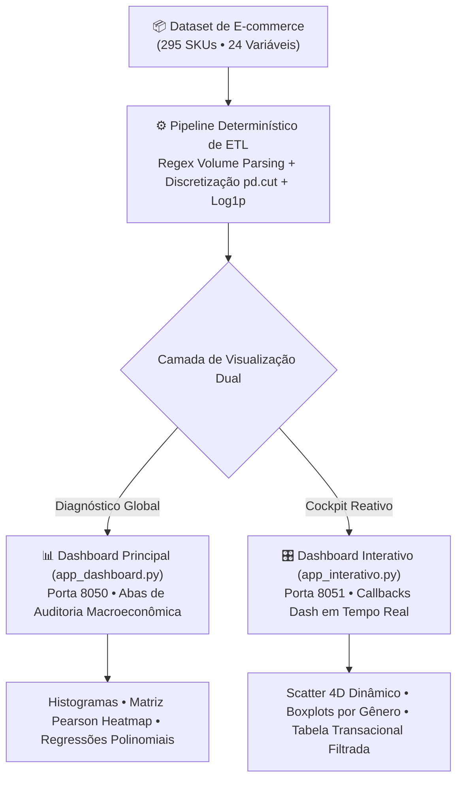

<div align="center">

# 🛒 E-commerce Analytics Dashboard

**Plataforma de Inteligência Analítica e Cockpit Interativo de Decisão para E-commerce**

[](https://www.python.org/)
[](https://dash.plotly.com/)
[](https://pandas.pydata.org/)
[](https://getbootstrap.com/)
[](https://scikit-learn.org/)

</div>

---


https://github.com/user-attachments/assets/2fa594f8-a654-4fb5-82b3-98e8706e3ebc


---

## 🎯 Visão Geral Executiva

Em operações dinâmicas de e-commerce, decisões críticas de sortimento, precificação e gestão de estoque frequentemente permanecem restritas a planilhas dispersas ou relatórios estáticos em Jupyter Notebooks. Sem uma visualização unificada e reativa, distorções severas de mercado passam despercebidas — gerando margens desalinhadas, estoques estagnados e perda contínua de receita.

O **E-commerce Analytics Dashboard** transforma uma base transacional de **295 produtos** e **24 dimensões de mercado** em uma plataforma interativa de inteligência de negócios. Desenvolvido com **Python**, **Dash** e **Plotly**, o sistema desacopla a análise em dois ambientes especializados: um painel de diagnóstico macroeconômico para auditoria global e um cockpit reativo para exploração operacional e granular de SKUs em tempo real.

---

## 💡 Principais Descobertas & Diagnósticos de Negócio

A auditoria matemática da base revelou anomalias críticas e oportunidades estratégicas:

1. **Disparidade de Gênero (+47,1% GAP)**: Produtos do segmento masculino apresentam preço médio de **R$ 154,97**, contra **R$ 105,32** no segmento feminino, sem justificativa de qualidade percebida.
2. **Independência entre Preço e Avaliação ($R^2 = 0,000$)**: A correlação linear de Pearson entre preço e nota é nula ($-0,01$), evidenciando que cobrar mais caro não amplia a satisfação do cliente.
3. **Risco de Estoque na Cauda Longa (50,8% dos SKUs)**: Mais da metade do catálogo comercializou 100 unidades ou menos, apontando capital de giro imobilizado em armazém.
4. **Alta Paridade de Qualidade (4,48 / 5,0 ★)**: 83,7% do sortimento possui classificação "Bom" ou "Excelente", validando o potencial de escala para marcas equilibradas.

---

## 🏗️ Arquitetura dos Dashboards

A plataforma adota uma abordagem arquitetural desacoplada para atender diferentes perfis de decisão:



### 1. Dashboard Principal (`app_dashboard.py` — Porta `8050`)
- **Foco**: Auditoria estatística e diagnóstico macroeconômico.
- **Navegação**: Abas estruturadas com histogramas de distribuição, matrizes de correlação de Pearson com mapas de calor, análises categóricas de materiais e regressões de tendências.

### 2. Cockpit Interativo (`app_interativo.py` — Porta `8051`)
- **Foco**: Exploração tática e operacional em tempo real.
- **Recursos**: Filtros dinâmicos multidimensionais (Gênero, Material e Faixa de Preço), KPIs que recalculam instantaneamente, gráficos de dispersão tetradimensionais (Preço vs Nota com tamanho por volume e cor por categoria) e tabela de dados transacionais com feedback em menos de 15 milissegundos.

---

## 📈 Diretrizes Estratégicas Recomendadas

- 📉 **Revisão de Preços Masculinos (-15% a -20%)**: Rebalanceamento de margem para aumentar elasticidade e conversão.
- 📈 **Expansão do Mix Feminino (+25% em Catálogo)**: Captura de fatia de mercado de alta tração com tíquetes equilibrados.
- 📦 **Saneamento da Cauda Longa**: Liquidação e descontinuação gradual dos 50,8% de itens estagnados, liberando liquidez de armazém.

---

## 🛠️ Como Executar Localmente

### 1. Pré-requisitos
Certifique-se de possuir o **Python 3.11+** instalado.

### 2. Instalação das Dependências
```bash
pip install dash plotly pandas numpy seaborn matplotlib scipy scikit-learn dash-bootstrap-components
```

### 3. Inicialização dos Dashboards

**Para acessar o Painel Macroeconômico:**
```bash
python app_dashboard.py
```
Acesse no navegador: `http://127.0.0.1:8050`

**Para acessar o Cockpit Interativo:**
```bash
python app_interativo.py
```
Acesse no navegador: `http://127.0.0.1:8051`

---

## 📂 Estrutura do Repositório

```text
ebac-ecommerce-dashboard/
├── assets/
│   └── demo.mp4                # Vídeo demonstrativo oficial em Full HD 1080p
├── app_dashboard.py            # Dashboard principal com visão macroeconômica e abas
├── app_interativo.py           # Cockpit reativo com callbacks e filtros dinâmicos
├── atividade.ipynb             # Análise exploratória original e modelagem estatística
├── ecommerce_estatistica.csv   # Base transacional consolidada (295 SKUs)
├── relatorio.md                # Relatório executivo detalhado de auditoria
└── README.md                   # Documentação arquitetural e guia de execução
```

---

<div align="center">
  Desenvolvido por <strong>César Carneiro</strong> — Gestor de Implementação de IA & Analista de Dados
</div>
